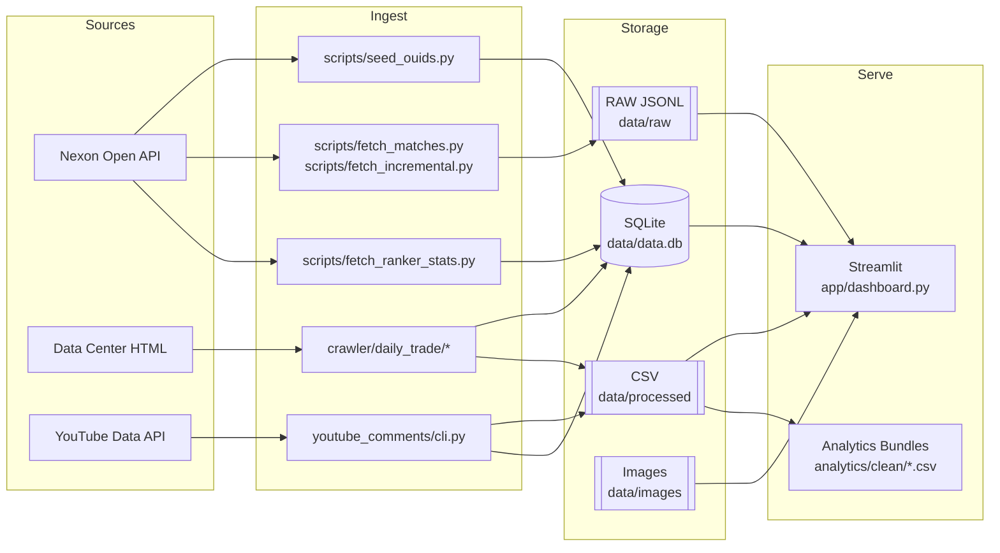

# FC Online Lab — 개발·크롤링 API 총합 가이드북 (MECE)
>
> 첫 사용자와 신규 기여자를 위한 단일 진입점 문서입니다. 개발 환경, 기술스택, 제품 요구(PRD), 아키텍처, 데이터 모델(ERD), 크롤링/오픈API 파이프라인, 운영 정책을 겹침 없이 MECE로 정리했습니다. 세부 근거 문서는 각 섹션 하단의 링크를 따르세요.
>
> 핵심 산출물: 로컬 SQLite(`data/data.db`), CSV(`data/processed/*.csv`), 이미지 캐시(`data/images/*.png`), 분석 아티팩트(`analytics/clean/*.csv`).


## 1) 비전·문제정의·성과지표 (PRD 핵심)
- 목적: Nexon FC Online Open API와 합법적 HTML 크롤링을 결합해 선수·거래·출전·주간지표를 안정적으로 축적/정규화/시각화
- 사용자: 데이터 애널리스트, 리서처, 대시보드 사용자, 신규 개발자
- 핵심 KPI:
  - 데이터 신뢰: 일별 파이프라인 성공률(≥ 95%), 중복/결측률(≤ 1%)
  - 커버리지: TOP N 랭커 최근 20경기 지표 주간 스냅샷 커버(≥ 90%)
  - 지연: 매일 09:00 KST 이전 최신 스냅샷 반영
  - 품질: 주요 차트/카드의 수치 재현성(샘플링 고정) 보장
- 범위(In): 증분 수집(429/쿼터 관리), 선수명/이미지 매핑, 로컬 DB, CSV 스냅샷, 대시보드
- 비범위(Out): 대규모 분산 배치, 사내 인증/SSO, 커스텀 감성모델 학습, 퍼블릭 서비스 운영
- 근거 문서: `docs/PRD.md`


## 2) 기술 스택 (MECE)
- 언어·런타임: Python 3.11+ (로컬 빌드 아티팩트는 CPython 3.13도 호환), PowerShell(Windows), Bash(Unix)
- 라이브러리:
  - HTTP/파서: `requests`, `beautifulsoup4`, `lxml`
  - 브라우저 자동화: `selenium`, `webdriver-manager`
  - 데이터/시각화: `pandas`, `matplotlib`, `streamlit`
  - 설정/유틸: `python-dotenv`
  - 테스트: `pytest`
- 저장소: SQLite(`data/data.db`), CSV(`data/processed`), JSONL(`data/raw`), 이미지 캐시(`data/images`)
- 키 관리: `.env` 또는 환경변수
  - `NEXON_OPENAPI_API_KEY` (Nexon Open API)
  - `YOUTUBE_API_KEY` (YouTube Data API v3)
- 참고: `requirements.txt`, `docs/DEV_ENV.md`, `README.md`


## 3) 전반 아키텍처 (Logical/Physical)

- 레이어 책임:
  - Sources: 공식/공개 데이터 원천 (정책 준수)
  - Ingest: API 호출/HTML 파싱/샘플링/품질게이트/멱등 UPSERT
  - Storage: 로컬 단일 파일 DB + 교환용 CSV + 추적 RAW + 이미지 캐시
  - Serve: 시각화/EDA/리포트
- 운영 정책: Rate-limit(TokenBucket), 재시도(지수 백오프), visited_log/seen_match로 멱등성 보장. 로깅은 파일+콘솔 UTC/KST 이원화. 참고 `docs/LOGGING.md`.


## 4) 데이터 모델(ERD)
```mermaid
erDiagram
  OUID_MAP {
    TEXT nickname PK
    TEXT ouid
  }
  SEEN_MATCH {
    TEXT match_id PK
  }
  META_KV {
    TEXT k PK
    TEXT v
  }
  PLAYERS {
    INTEGER spid PK
    TEXT name_kor
    TEXT name_eng
    TEXT image_path
    TEXT updated_at
  }
  RANKER_STATS {
    INTEGER spid
    INTEGER po
    TEXT    create_date
    INTEGER dribble
    INTEGER dribble_try
    INTEGER dribble_success
    INTEGER pass_try
    INTEGER pass_success
    INTEGER block
    INTEGER tackle
    INTEGER assist
    INTEGER goal
    INTEGER match_count
    PK (spid, po, create_date)
  }
  DAILY_TRADE {
    TEXT date
    INTEGER spid
    TEXT player_name
    BIGINT avg_price
    BIGINT max_price
    BIGINT min_price
    INTEGER trade_count
    INTEGER max_enhance_level
    TEXT source
    PK (date, spid)
  }
  DAILY_TOP_PLAYERS {
    TEXT date
    INTEGER spid
    INTEGER rank
    REAL pick_rate
    PK (date, spid)
  }
  DAILY_PICK {
    TEXT date
    INTEGER spid
    INTEGER matchtype
    INTEGER pick_count
    INTEGER sample_match_count
    TEXT source
    PK (date, spid, matchtype, source)
  }
  COMMENTS {
    INTEGER id PK
    TEXT video_id
    TEXT video_title
    TEXT comment_id UNIQUE
    TEXT author
    TEXT text
    INTEGER like_count
    TEXT published_at
    TEXT updated_at
    INTEGER is_reply
    TEXT parent_id
  }

  PLAYERS ||--o{ RANKER_STATS : has
  PLAYERS ||--o{ DAILY_TRADE : priced
```
- 물리 스키마 소스: `app/core/cache.py`, `crawler/daily_trade/writer.py`, `youtube_comments/storage.py`, `docs/ERD.md`
- 인덱스 권장: `ranker_stats(create_date,spid,po)`, `daily_pick(date,spid)`


## 5) 파이프라인 명세 (MECE)
- 랭커 주간지표 스냅샷(API)
  - 입력: `pairs.json` 또는 `pairs_clean.json`의 `{id: spid, po}` 목록
  - 처리: `scripts/fetch_ranker_stats.py` → 50개 배치 쿼리 → UPSERT `ranker_stats`
  - 출력: `data/data.db` 테이블 `ranker_stats`
  - 실행 예:
    ```bash
    python scripts/fetch_ranker_stats.py --pairs pairs.json \
      --api-key $env:NEXON_OPENAPI_API_KEY
    ```
- 증분 매치 RAW 수집(API)
  - 입력: 닉네임 목록(`config/rankers.txt` 등)
  - 처리: OUID 캐시(`ouid_map`) 결합 → `user/match` 페이징 → `match-detail` 상세 저장(JSONL) → `seen_match` 멱등
  - 출력: `data/raw/matches_sample.jsonl`
  - 실행 예:
    ```bash
    python scripts/fetch_incremental.py --nick A B C --pages 2 --remain 500 \
      --api-key $env:NEXON_OPENAPI_API_KEY
    ```
- 거래/TopN 크롤링(HTML)
  - 입력: 날짜 범위, 대상 선수 목록(JSON/CSV)
  - 처리: `crawler/daily_trade/{fetcher,parser,writer}.py` → 품질검사 → UPSERT `daily_trade`, `daily_top_players` → CSV 내보내기(옵션)
  - 출력: DB(`daily_trade`, `daily_top_players`, `daily_pick`), CSV(`data/processed/*.csv`)
  - 실행 예:
    ```bash
    python -m crawler.daily_trade.cli \
      --start-date 2025-08-13 --end-date 2025-09-10 \
      --players data/meta/sample_players.json \
      --export-csv --db data/data.db
    ```
- YouTube 댓글 수집
  - 입력: 영상 ID/URL 1개 이상, `YOUTUBE_API_KEY`
  - 처리: API 페이지네이션 → 스팸/URL 필터링 → 균형 샘플링(옵션) → CSV/SQLite 저장
  - 출력:
    - CSV: `data/processed/gamst_comments.csv` 또는 사용자 지정
    - SQLite: `data/processed/gamst_comments.db` 테이블 `comments`
    - 클린 병합본: `analytics/clean/comments.clean.csv` (EDA/대시보드 가공 결과; 현재 10,495×24, 기간 2022-04-02~2025-09-03)
  - 실행 예:
    ```bash
    python -m youtube_comments.cli \
      --videos <VIDEO_ID_1> <VIDEO_ID_2> \
      --balanced --include-replies --print-counts \
      --csv-out data/processed/gamst_comments.csv \
      --sqlite-out data/processed/gamst_comments.db
    ```


## 6) API 계약(요약)
- Nexon Open API
  - 인증: 헤더 `x-nxopen-api-key: <key>`
  - 엔드포인트: `id`(닉→OUID), `user/match`(최대 100/페이지, offset), `match-detail`, `ranker-stats?players=[{id,po},...]`
  - 한도: 429 처리(지수 백오프), 초당 RPS 토큰버킷(`app/core/rate_limit.py`), 일일 잔여 예산 분배(`compute_daily_budget`) 권장
- Data Center(HTML)
  - 대상: 일일 거래/TopN, 셀렉터 버전 관리(`docs/check/version_selectors.yaml`), 레이아웃 변화 시 스냅샷 저장(`data/raw/html/*.html`)
  - 정책: robots/요청 간격 준수, 무해화된 UA, 무차별적 크롤링 금지
- YouTube Data API v3
  - 인증: `key` 파라미터
  - 엔드포인트: `videos`, `commentThreads`, `comments`

자세한 스펙: `docs/FCOnline_OpenAPI_full.md`, `crawler/daily_trade/README.md`, `docs/SOURCES.md`


## 7) 개발자 Onboarding (10분 셋업)
- 종속성:
  - Python 설치 후 가상환경 권장: `python -m venv .venv && .\\.venv\\Scripts\\Activate.ps1`
  - 설치: `python -m pip install -r requirements.txt`
- 키 설정:
  - `.env` 파일에 `NEXON_OPENAPI_API_KEY=...`, `YOUTUBE_API_KEY=...`
- 빠른 점검:
  - 메타/이미지: `python scripts/sync_players.py --spids pairs_small.json --download`
  - 샘플 수집: `python scripts/fetch_ranker_stats.py --pairs pairs_small.json`
  - 대시보드: `streamlit run app/dashboard.py`
- 구조 파악: `docs/STRUCTURE.md`, `CODEMAP.md`, `docs/CODE_TECHNICAL_SUMMARY_KR.md`


## 8) 운영 수칙·품질·보안
- 품질 게이트:
  - 스키마 유효성: `crawler/daily_trade/writer._validate_*`, 타입/범위 체크 후 경고-스킵
  - 멱등성: `PRIMARY KEY`+`INSERT OR REPLACE`(UPSERT), `visited_log`/`seen_match`로 중복 방지
  - 회복성: 429/5xx 지수 백오프, 부분 실패 시 다음 단위 계속, 스냅샷 남김
- 로그·관측성:
  - 파일: `logs/*.log`(UTC ISO8601), 콘솔: KST, 구조화 로그(`app/core/utils.jlog`)
  - 실행 캡처: `scripts/run_with_log.ps1`
- 보안·프라이버시:
  - 키는 환경 변수/Secrets. 코드/로그에 키/민감정보 기록 금지
  - 공개 소스만 수집, robots 준수, 약관 준수. 자세히: `docs/CRAWLING_POLICY.md`, `docs/PRIVACY.md`
- 데이터 수명:
  - RAW(JSONL)는 증거 보존 목적 최소화·회전 정책 권장, CSV/DB는 멱등 재생성 가능


## 9) 대시보드·분석 산출물
- Streamlit 대시보드: `app/dashboard.py`, `app/sentiment_dashboard.py`
- 최신 클린 데이터:
  - 가격/TopN: `analytics/clean/best_price_daily.clean.csv`, `analytics/clean/top_daily_record.clean.csv`
  - 댓글(감성/엔티티 포함): `analytics/clean/comments.clean.csv`
- 설명 문서: `docs/analysis/BDD_KR_2025/INDEX.md` 및 하위 설명들


## 10) 러프 로드맵·리스크
- 로드맵: 셀렉터 변경 자동 회복(휴리스틱+버전 매핑), ERD 확장(매치/트레이드 사실 테이블), 대시보드 지표 템플릿화
- 주요 리스크: 레이트리밋/쿼터, 레이아웃 변경, 명명/시즌 코드 정합성, 댓글 API 쿼터
- 대응: 토큰버킷/예산 분배, 스냅샷·버전 테이블, 정규화 매핑, 균형 샘플링·스팸필터


## 11) 파일 맵(핵심 경로)
- 코드: `app/core/*`, `app/services/*`, `crawler/daily_trade/*`, `scripts/*`, `youtube_comments/*`
- 데이터: `data/data.db`, `data/raw/*.jsonl`, `data/processed/*.csv`, `data/images/*.png`
- 문서: `docs/PRD.md`, `docs/ERD.md`, `docs/LOCAL_ARCHITECTURE_OVERVIEW_KR.md`, `docs/LOGGING.md`, `docs/BEGINNER_GUIDE_KR.md`


## 부록) 자주 쓰는 명령 모음
```bash
# 1) OUID 프리시드
python scripts/seed_ouids.py --file config/rankers.txt --save-ranker-sample \
  --api-key $env:NEXON_OPENAPI_API_KEY

# 2) 증분 RAW 수집
python scripts/fetch_incremental.py --nick A B C --pages 2 --remain 500 \
  --api-key $env:NEXON_OPENAPI_API_KEY

# 3) 랭커 주간지표
python scripts/fetch_ranker_stats.py --pairs pairs.json --api-key $env:NEXON_OPENAPI_API_KEY

# 4) 거래/TopN 크롤링
python -m crawler.daily_trade.cli --start-date 2025-08-13 --end-date 2025-09-10 \
  --players data/meta/sample_players.json --export-csv --db data/data.db

# 5) 유튜브 댓글 수집(균형 샘플)
python -m youtube_comments.cli --videos <VID1> <VID2> --balanced --include-replies \
  --csv-out data/processed/gamst_comments.csv --sqlite-out data/processed/gamst_comments.db

# 6) 대시보드 실행
streamlit run app/dashboard.py
```


---
참고 링크 요약: `docs/PRD.md`, `docs/ERD.md`, `docs/LOCAL_ARCHITECTURE_OVERVIEW_KR.md`, `docs/LOGGING.md`, `docs/CRAWLING_POLICY.md`, `docs/PRIVACY.md`, `docs/analysis/BDD_KR_2025/INDEX.md`.
