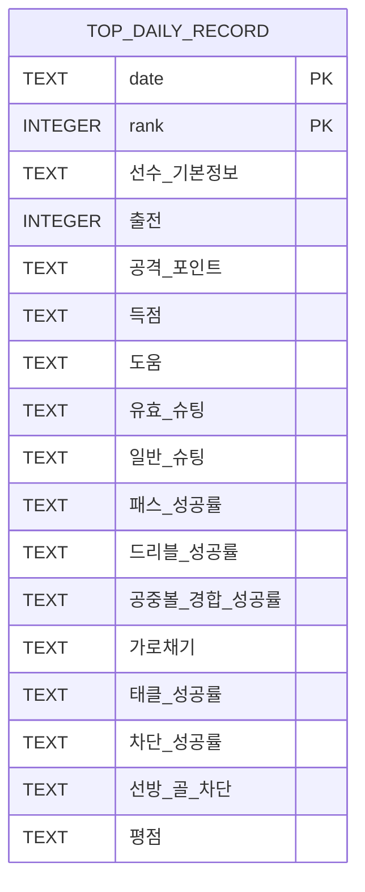

# ERD: 출전 랭킹(프로젝트2)

- 물리 테이블: `top_daily_record` (SQLite)
- PK: (date, rank)
- 입력 경로: `project2/app/parser` → `project2/app/writer.write_db`
- 참고: CSV는 월별 파일(`topdailyrecord_YYYY-MM.csv`)로 동일 스키마 헤더 사용

